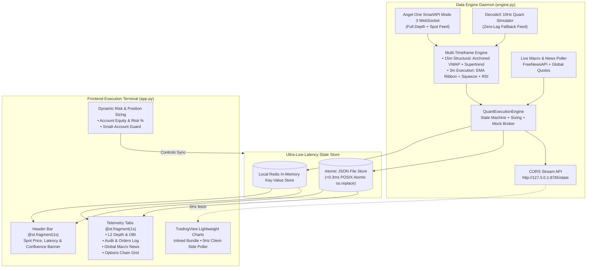

# DecodeX Trading — Institutional Multi-Timeframe Quant Terminal

**DecodeX Trading** is an institutional quantitative trading terminal and statistical research platform designed for Indian index derivatives (**NIFTY 50**, **BANK NIFTY**, **BSE SENSEX**).

The system utilizes a decoupled high-frequency architecture: an asynchronous headless Python daemon (`engine.py`) continuously processes broker WebSocket streams, Level-2 microstructure, options chain Greeks, and multi-timeframe indicators into an ultra-low-latency state store (`data/state_store.py`), paired with an interactive Streamlit terminal (`app.py`) featuring embedded TradingView Lightweight Charts, real-time 5Hz updates, and dynamic risk guardrails.

> [!CAUTION]
> **Regulatory & Risk Disclaimer**: This platform is strictly for quantitative research, automated paper execution, and statistical decision support. Market participation and derivatives trading involve substantial financial risk.

---

## 🏗️ Architecture & Decoupled Execution Pipeline



---

## ⚡ Core Modules & Features

### 1. Real-Time Data Pipeline & Latency Telemetry (`engine.py`)
- **Angel One SmartAPI Mode 3 (FULL_SNAP)** WebSocket integration with automated exponential backoff ($2\text{s} \to 4\text{s} \to 8\text{s} \to \dots \le 60\text{s}$) and reconnect watchdog.
- **Zero-Downtime Fallback**: Automatically switches to the low-latency 10Hz quant simulator during after-hours or API drops so charts and state machines never stall.
- **Unified Continuous Historical Warmup**: Smoothly joins previous session afternoon close (13:00–15:30 IST) into today's 09:15 AM IST session, guaranteeing exact 15m and 3m closing price consistency without artificial spikes.
- **Low-Latency Telemetry**: Live pipeline latency tracking (e.g. `⚡ 12.0ms Latency | 10Hz Feed`).

### 2. 6-Factor MTF Confluence State Machine (`data/execution_engine.py`)
$$\text{WAIT} \longrightarrow \text{EXECUTE} \longrightarrow \text{POSITION\_OPEN} \longrightarrow \text{TRAILING\_STOP} \longrightarrow \text{TARGET\_HIT} \; / \; \text{STOPPED\_OUT}$$
- **15m Structural Bias**: Anchored Session VWAP and Supertrend $(10, 2.5)$.
- **3m Execution Triggers**: EMA Ribbon $(9, 21, 50)$, Volatility Squeeze (Bollinger Bands vs Keltner Channels), and RSI(14) momentum filter.
- **Dual Operating Modes**:
  - `Active Quant Execution (Live Signals)`: Auto-dispatches orders to mock broker and logs entries to the persistent DuckDB ledger when Confluence Score $\ge 4.0$.
  - `Strict Risk Gatekeeper (Read-Only)`: Suppresses trade execution and generates audit alerts.
- **3-Stage Breakeven Lock & Runner Trailing SL**:
  - **Stage 0**: Initial $1.5 \times \text{ATR}$ stop-loss.
  - **Stage 1**: Target 1 reached $\to$ Stop-loss automatically moves to Entry (Breakeven Locked).
  - **Stage 2**: Price advances $> 1.8 \times \text{ATR}$ $\to$ Trailing stop advances at $1.0 \times \text{ATR}$ behind price.

### 3. Dynamic Position Sizing & Small-Account Guard (`data/risk_engine.py`)
- **Capital Allocation Formulas**:
  $$\text{Max Risk (INR)} = \text{Account Equity} \times \left(\frac{\text{Risk } \%}{100}\right)$$
  $$\text{Stop Distance} = \text{Daily ATR} \times \text{Multiplier}$$
  $$\text{1-Lot Risk} = \text{Stop Distance} \times \text{Lot Size}$$
  $$\text{Recommended Lots} = \left\lfloor \frac{\text{Max Risk}}{\text{1-Lot Risk}} \right\rfloor$$
- **Small-Account Guard**: If 1 minimum lot risk exceeds total allocated risk budget, order execution is strictly blocked (`BLOCKED`), size set to 0, and a warning is surfaced.

### 4. High-Performance Frontend Terminal (`app.py`)
- **Flicker-Free TradingView Supercharts**: Inlined TradingView Lightweight Charts bundle updating at 5Hz via client-side polling (`http://127.0.0.1:8765/state`) with zero iframe reloads.
- **Dedicated Sub-Header HUD**: Clean OHLC + indicator metrics strip without visual text overlap on chart candles.
- **Institutional Telemetry Tabs**:
  - `⚡ L2 Depth`: 5-level market depth matrix with Order Book Imbalance (OBI) and micro-price.
  - `📜 Audit & Orders`: Real-time position card (Strike, Entry, SL, Target, Unrealized PnL) and rolling event log.
  - `📰 Market News`: Live Indian financial headlines and global macro quotes (USD/INR, Brent, US10Y).
  - `📊 Options Grid`: Real-time ATM $\pm$ 200 triad with COI deltas, IVs, and Greeks.
- **Web Audio Chime**: Synthesized zero-dependency browser chime on signal shifts and order execution.

---

## 🚀 Quickstart & Setup

### 1. Environment Preparation
```bash
python3.12 -m venv .venv
source .venv/bin/activate
pip install -r requirements.txt
```

### 2. Configure Credentials (`.env`)
```bash
cp .env.example .env
# Edit .env with your Angel One SmartAPI credentials (optional for quant simulator mode):
# ANGEL_API_KEY=...
# ANGEL_CLIENT_ID=...
# ANGEL_MPIN=...
# ANGEL_TOTP_SECRET=...
```

### 3. Launch the Terminal

Open two terminal tabs:

**Terminal 1 — Start Data Engine Daemon:**
```bash
source .venv/bin/activate
python engine.py --instrument NIFTY --expiry 17NOV2026
```

**Terminal 2 — Start Streamlit Frontend:**
```bash
source .venv/bin/activate
streamlit run app.py
```
*(Navigate to `http://localhost:8501` in your browser).*

---

## 🧪 Testing & Verification

Run the full quant execution, decoupled architecture, and macro test suite:
```bash
source .venv/bin/activate
pytest tests/test_quant_execution.py tests/test_decoupled_architecture.py tests/test_options_and_macro.py -v
```

---

## 📁 Repository Structure

```text
├── app.py                         # Streamlit quant execution dashboard
├── engine.py                      # Headless async quant data daemon & CORS API
├── types/
│   └── decodex.ts                 # TypeScript data contracts & interfaces
├── dashboard/
│   ├── app.py                     # Redirect pointer to root app.py
│   ├── tradingview_streamlit.py   # Inlined TradingView bundle & 5Hz live poller
│   ├── tradingview_bridge.py      # Lightweight Charts HTML generators
│   └── static/                    # Local lightweight-charts production bundle
├── data/
│   ├── state_store.py             # Ultra-low-latency Redis + atomic JSON file store
│   ├── execution_engine.py        # 6-Factor MTF confluence state machine & mock broker
│   ├── risk_engine.py             # Dynamic risk sizing & Small-Account Guard
│   ├── storage.py                 # DuckDB historical OHLCV storage
│   ├── paper_trading.py           # Persistent paper trading database ledger
│   └── angel_provider.py          # Angel One SmartAPI provider
├── signals/
│   ├── macro_sentiment.py         # Indian financial news & global macro scraper
│   └── engine.py                  # Quantitative signal engine
├── tests/
│   ├── test_quant_execution.py    # Unit tests for risk sizing, gatekeeper, & trailing SL
│   ├── test_decoupled_architecture.py # Unit tests for StateStore and engine state
│   └── test_options_and_macro.py  # Unit tests for options chain and news sentiment
├── config/
│   ├── config.yaml                # Master configuration file
│   └── holidays.yaml              # NSE/BSE holiday schedule
└── requirements.txt               # Pinned Python dependencies
```
